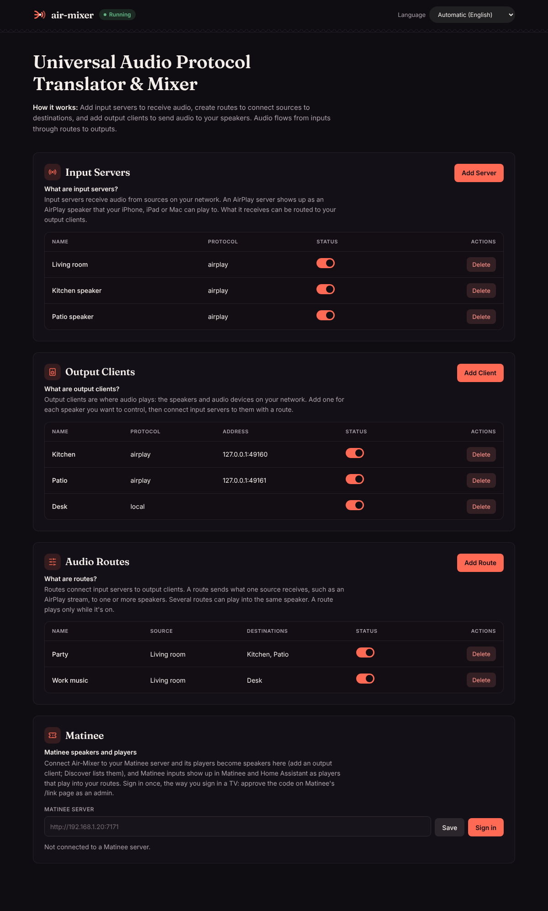
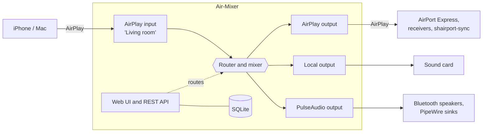

<p align="center">
  
</p>

<p align="center">
  <a href="https://github.com/yeixio/air-mixer/actions/workflows/ci.yml"></a>
  <a href="https://github.com/yeixio/air-mixer/releases/latest"></a>
  <a href="https://goreportcard.com/report/github.com/yeixio/air-mixer"></a>
  <a href="https://pkg.go.dev/github.com/yeixio/air-mixer"></a>
  <a href="LICENSE"></a>
  <a href="https://github.com/yeixio/air-mixer/issues?q=is%3Aissue+is%3Aopen+label%3A%22good+first+issue%22"></a>
  <a href="https://yeix.io/donate/air-mixer"></a>
</p>

<p align="center">
  <a href="#quick-start">Quick start</a> ·
  <a href="docs/API.md">REST API</a> ·
  <a href="docs/ARCHITECTURE.md">Architecture</a> ·
  <a href="ROADMAP.md">Roadmap</a> ·
  <a href="CONTRIBUTING.md">Contributing</a> ·
  <a href="#the-yeix-ecosystem">Ecosystem</a>
</p>

Air-Mixer is a small self-hosted server that unifies speakers from different
ecosystems behind one web UI and one REST API. It receives audio from your
devices, mixes it, and plays it on any combination of speakers, whatever
protocol they speak.

Today it receives classic AirPlay and AirPlay 2, Bluetooth, Spotify
Connect, DLNA and internet radio, records any PulseAudio or PipeWire
source, and plays on classic AirPlay speakers, the machine's own sound
card, any PulseAudio or PipeWire sink including paired Bluetooth speakers,
Google Cast devices, Sonos and other UPnP/DLNA renderers, and Snapcast.
An AirPlay 2 output is on the [roadmap](ROADMAP.md).

<p align="center">
  
</p>

## What it does

- **AirPlay receiver.** Each input you create appears on iPhones and Macs as
  an AirPlay speaker. Pick it in Control Center and play.
- **AirPlay sender.** Plays to AirPort Express, shairport-sync, most
  AV receivers and other classic AirPlay (RAOP) speakers.
- **Internet radio input.** Plays a station, a PLS, M3U or HLS playlist
  or an audio file from a URL for as long as it is on, reconnecting when
  the station drops. AAC, Ogg, Opus and FLAC go through ffmpeg, which the
  Docker image includes.
- **Bluetooth input.** Air-Mixer shows up as a Bluetooth speaker: phones
  and laptops pair with it from their Bluetooth settings and play. It
  drives BlueZ over D-Bus and records through PipeWire or PulseAudio.
- **Spotify Connect input.** Shows up as a speaker in the Spotify app,
  through [librespot](https://github.com/librespot-org/librespot).
- **AirPlay 2 input.** Shows up as an AirPlay 2 speaker that Apple devices
  can add to multi-room groups, through
  [shairport-sync](https://github.com/mikebrady/shairport-sync) built with
  AirPlay 2 support.
- **Line-in input.** Records any PulseAudio or PipeWire source: a
  line-in, a USB audio interface, or a sink's monitor.
- **Google Cast output.** Plays on Chromecast, Nest and Google Home
  speakers, speaker groups and Cast TVs, and lets go of them when it goes
  quiet or someone casts something else.
- **UPnP/DLNA, both ways.** Plays on Sonos, AV receivers, smart TVs and
  other DLNA renderers, and appears as a renderer that apps like
  BubbleUPnP and Windows' "Cast to Device" can play to.
- **Snapcast output.** Feeds a snapserver TCP source, so every Snapcast
  client in the house plays in sync.
- **Local output.** Plays on the server's own default audio device.
- **PulseAudio and Bluetooth output.** Plays to any PulseAudio or PipeWire
  sink, picked by name or by a Bluetooth speaker's address, so one
  Air-Mixer can drive every Bluetooth speaker paired with its host. Each
  output can be delayed to line up speakers with different latencies.
- **Kubernetes native.** A [Helm chart](deploy/helm/airmixer) runs the main
  Air-Mixer plus a speaker agent on each node that has speakers paired,
  such as a Raspberry Pi in a room. See [Kubernetes](docs/KUBERNETES.md).
- **Matinee, both ways.** Play anything from a [Matinee](https://github.com/yeixio/matinee)
  library on your speakers: a Matinee input shows up in Matinee and Home
  Assistant as a player. And any Matinee player, such as a TV, becomes a
  speaker you can route to. See [Matinee](docs/API.md#matinee).
- **Stream output.** Any output can be a live WAV stream for VLC or a
  browser.
- **Routing and mixing.** A route sends one input to any number of
  outputs. Several routes into one output are mixed, each with its own
  volume. Routes refer to devices by name, so they survive a device being
  removed and added again.
- **Announcements and alarms.** Play a clip, text-to-speech or a stream
  from a URL on any set of outputs, ducking or silencing the music and
  bringing it back afterwards.
- **Home Assistant.** A [custom integration](docs/HOME_ASSISTANT.md)
  makes every output a media player, so Home Assistant can send speech,
  doorbells and house-wide alarms.
- **Discovery.** Finds AirPlay speakers, Google Cast devices, Sonos and
  other DLNA renderers, and Snapcast servers on your network.
- **Web UI and REST API.** Everything the UI does is available over a
  [documented JSON API](docs/API.md).
- **32 languages.** The web UI and API errors come in the same languages as
  [Matinee](https://github.com/yeixio/matinee), right to left for Arabic,
  Hebrew, Persian and Urdu. It starts in the browser's language and has a
  picker in the header. See [Translations](i18n/README.md).
- **Single static binary.** Pure Go, no cgo: the web UI, SQLite and the
  ALAC codec are all built in. Cross-compiles to Linux, macOS and Windows.

## How it works

Inputs (called **servers**) receive audio, **routes** send it to one or
more outputs (called **clients**), and every output mixes the routes that
feed it, each at its own volume.



[docs/ARCHITECTURE.md](docs/ARCHITECTURE.md) follows the audio through
each package.

## Quick start

### Docker

```bash
git clone https://github.com/yeixio/air-mixer.git
cd air-mixer
docker compose up -d
```

Open <http://localhost:9001>. The container uses host networking because
AirPlay discovery relies on multicast DNS.

### Kubernetes

```bash
helm install airmixer deploy/helm/airmixer -f my-values.yaml
```

The chart runs the main Air-Mixer and a speaker agent for each room, on
the node its Bluetooth speakers are paired with. Multi-arch images
(amd64, arm64, armv7) are published to `ghcr.io/yeixio/air-mixer`. See
[docs/KUBERNETES.md](docs/KUBERNETES.md) for setting up a Raspberry Pi
room.

### Release binaries

Each [release](https://github.com/yeixio/air-mixer/releases) has archives
for Linux (amd64, arm64, armv7 for a Raspberry Pi), macOS (Intel and Apple
silicon) and Windows, with a `checksums.txt`. Unpack one and run
`./airmixer server`.

### From source

Requires Go 1.26 or later.

```bash
git clone https://github.com/yeixio/air-mixer.git
cd air-mixer
make build
./build/airmixer server
```

Or install straight from the module:

```bash
go install github.com/yeixio/air-mixer/cmd/airmixer@latest
airmixer server
```

On Linux, local playback goes through PulseAudio or PipeWire's PulseAudio
service. Headless servers that only bridge AirPlay devices do not need one.

### First steps

1. Open the web UI at <http://localhost:9001>.
2. Add an **input server** (protocol `airplay`). It shows up as a speaker
   on your Apple devices.
3. Add one or more **output clients**: AirPlay speakers (use Discover to
   find them), `local` for the server's sound card, or `pulse` for a
   Bluetooth speaker or other PulseAudio sink.
4. Create a **route** from the input to the outputs, then play something.

## Configuration

Air-Mixer reads `config.yaml` from the working directory, `~/.airmixer/` or
`/etc/airmixer/`, or the file given with `--config`. Every setting can also
be set through an environment variable such as `AIRMIXER_SERVER_WEB_PORT`.
See [config.yaml.example](config.yaml.example) for all settings and their
defaults.

Servers, clients and routes are stored in SQLite under `data_dir` and are
managed through the UI or the API. They can also be declared in the
config file's `setup` section, which is applied on every start; that is
how the Helm chart configures each room.

## Command line

```text
airmixer server     Run the server (aliases: start, serve)
airmixer version    Print version information
  -c, --config      Path to a config file
```

## Current limitations

- **AirPlay 2 output.** Air-Mixer sends classic AirPlay (RAOP). Devices
  that only accept AirPlay 2, such as recent Apple TVs and HomePods, need
  HomeKit pairing, which is not implemented yet; they show as `failed` in
  `/api/status`.
- **Receiver programs.** The Spotify Connect and AirPlay 2 inputs run
  `librespot` and `shairport-sync` (built with AirPlay 2, with `nqptp`
  running), which are not in the Docker image yet. The web UI greys these
  inputs out until the programs are on the server's `$PATH`.
- **Google Cast input, Spotify Connect output.** Neither can be built:
  a Cast receiver needs device certificates signed by Google, and Spotify
  offers no way to send audio to a Connect speaker from outside its apps.
- **Synchronisation.** Each output plays with its own buffering, so
  speakers in different rooms are not sample-aligned yet.
- **Mix modes.** All routes into an output are mixed. The `mix_mode` field
  is stored but an exclusive mode is not implemented yet; ducking is
  available for playback (announcements) only.

## The Yeix ecosystem

Air-Mixer is one of a family of free, self-hosted apps for the home, each
useful on its own:

| Project | What it does |
|---------|--------------|
| **Air-Mixer** | One home for every speaker you own: receives, routes and mixes audio across speakers from different ecosystems. |
| [**Matinee**](https://github.com/yeixio/matinee) | A fast, open-source media server for your movies, TV, music, audiobooks and podcasts, with web, phone and TV apps. Air-Mixer plays Matinee on your speakers and uses Matinee players as speakers ([how](docs/API.md#matinee)). |
| [**Box Office**](https://github.com/yeixio/boxoffice) | Manages your movie and TV library in place of Radarr, Sonarr and NZBGet, and plugs straight into Matinee. |

## Documentation

- [Architecture](docs/ARCHITECTURE.md): how audio flows through the system
- [REST API](docs/API.md)
- [Home Assistant](docs/HOME_ASSISTANT.md)
- [Kubernetes](docs/KUBERNETES.md): Helm chart and Raspberry Pi speaker rooms
- [Translations](i18n/README.md): languages, and how to review or add text
- [Testing](docs/TESTING.md)
- [Roadmap](ROADMAP.md)
- [Changelog](CHANGELOG.md)
- [Getting help](SUPPORT.md)
- [Contributing](CONTRIBUTING.md)

## Contributing

Contributions are welcome, from bug reports to new protocol adapters.
Read [CONTRIBUTING.md](CONTRIBUTING.md) to get started. Good places to
begin:

- **[Good first issues](https://github.com/yeixio/air-mixer/issues?q=is%3Aissue+is%3Aopen+label%3A%22good+first+issue%22)**:
  small, well-scoped tasks with pointers to the code involved.
- **[Help wanted](https://github.com/yeixio/air-mixer/issues?q=is%3Aissue+is%3Aopen+label%3A%22help+wanted%22)**:
  bigger pieces such as Google Cast, UPnP/DLNA and Sonos, AirPlay 2 and
  synchronised multi-room playback.
- **[Device reports](https://github.com/yeixio/air-mixer/issues/new?template=device_report.yml)**:
  tell us how Air-Mixer works with your speakers. CI can't test real
  hardware, so these matter.

Please report security problems privately as described in
[SECURITY.md](SECURITY.md), and follow the
[code of conduct](CODE_OF_CONDUCT.md).

<a href="https://github.com/yeixio/air-mixer/graphs/contributors">
  
</a>

## Acknowledgements

The ALAC decoder is a Go port of David Hammerton's ALAC decoder, and the
AirPlay implementation follows the protocol work of the shairport and
shairport-sync projects. See [NOTICE](NOTICE).

## Support Air-Mixer

Air-Mixer is free and open source. If it's useful to you, you can [donate to Air-Mixer](https://yeix.io/donate/air-mixer), once or monthly, by card. Donations pay for its development. Nothing is held back for donors.

[](https://yeix.io/donate/air-mixer)

## License

[MIT](LICENSE)
